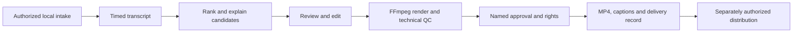

# ClipOps Studio release candidate

**Current desktop status (November 20, 2026):** `main` includes the integrated local Studio plus PR #16 source moment finder and visual scene reviewer at merge `9e5e55b7cb34307dd80096b8c8cfa44eed635e7a`. The following 89-test narrative and branch paths are historical RC evidence; the newer feature-commit CI passed 125 repository + 4 transcript-brief tests, desktop/mobile browser and release package. See [current audit and unverified TODOs](docs/DESKTOP_RELEASE_AUDIT_2026-11-20.md).

**GO for a supervised, local first-video test with authorized footage.** Use a reviewed timestamped transcript for Egyptian Arabic or mixed-language material. **NO-GO for unsupervised client delivery, public uploads or live distribution.** The real-footage acceptance scores remain unmeasured.

The isolated branch is `local/final-pilot-rc`, based on PR #5 at `aa6d38a`, with PR #4 in its ancestry. The first-video command, browser startup, output format and review flow are in [PILOT.md](PILOT.md). Repository relationships, PR #151, pricing boundaries, transport status and dependency evidence are in [stack verification](docs/STACK_VERIFICATION.md). [Editor benchmark](docs/EDITOR_BENCHMARK.md)

## What ships

- One local pilot pipeline for private intake, chunk-cached CPU/GPU-optional ASR, speaker labeling, transcript-informed ranking with reasons and duplicate suppression, edit revisions, FFmpeg rendering, technical QC and approved delivery.
- A desktop and mobile review desk with source seeking, clip playback, editable transcript and copy, trim and reviewed internal cuts, batch rendering, names on review decisions, brand color and typography, and approved downloads.
- Nine visual presets and five output formats. The renderer offers source-preserving, crop, speaker and split layouts, conservative optional face guidance, measured caption safe areas, timed word emphasis, Arabic shaping, speech cleanup, loudness normalization, and rights-confirmed local inserts. 4K output checks the source dimensions and layout for pixel support.
- Approvals bind the approved media and caption files to their SHA-256 digests. Settings and caption changes invalidate the existing clip revision. A local job directory stores state, output and caches. The existing Postiz queue still requires explicit rights, review and opt-in. It now binds new approvals to the exact media bytes.

## Verification

| Run | Observed result |
| --- | --- |
| Existing baseline | 52 local tests passed before implementation. |
| Final regression suite | 89 local tests passed. Includes approval integrity, corrupt and mismatched input, caption layout and sidecars, native 4K, missing or distorted audio, black frames, freeze, A/V alignment, interruption and a fractional-frame speech cut. |
| Desktop and mobile Chromium | Imported a synthetic MP4 and transcript, searched and edited captions, changed rendering settings, applied a reviewed internal cut, rendered the selection, played it, checked approval restrictions and downloaded MP4, SRT and VTT. Viewports were 1390 × 1000 and 390 × 844. |
| Interrupted FFmpeg run | Sent SIGINT during the second render. The command exited 130. Resuming reused the completed first bundle and rendered the second. Both clips passed QC. |
| Four playable previews | Split-screen podcast, word-highlight podcast, Arabic/English lesson, and square fashion clip with a rights-confirmed local cutaway. All four passed full technical QC. Frames were inspected for caption legibility and composition. |
| 60-minute repeated synthetic input, transcript supplied | 981 timed cues produced 4 ranked candidates after duplicate suppression. Ranking took 3.8 seconds. Two 1080p candidates rendered and passed QC in 84.5 seconds total. |
| Same source, offline multilingual tiny model in English mode | 993 timed segments and 7 candidates in 300.4 seconds, with 295.0 CPU seconds and a 563.8 MiB process/child high-water report. Candidate count is a test observation on repeated material. |
| 36-second synthetic English recognition | Zero token errors in 89 reference words for the final local tiny-model run. The optional speaker model returned two labels across the ten speech segments. |
| 24-second synthetic Arabic/English recognition | Tiny mixed mode had 35 errors over 43 reference words (81.4% WER). Small mixed mode had 27 (62.8%). Small forced Arabic had 26 (60.5%). Reviewed captions are required for this material. |

The runner used Debian 13, FFmpeg 7.1.5, Python 3.12, an effective two-CPU quota, and no GPU device. Several measured runs overlapped on the runner. The synthetic hour repeats short material and had a probed length of 3600.08 seconds in the two measured runs. Fresh fixture generation yields 3600.0 seconds. These runtime results guide the first test. Diverse footage, capture formats and real editorial effort still need measurement.

The pinned Python environment audit checked 27 installed versions after upgrading pip to 26.3. PyPI's advisory feed returned zero known advisories for that set. Debian's tracker still lists open media dependency records whose reachability requires triage. Keep this pilot on a trusted workstation. [Media dependency evidence](docs/STACK_VERIFICATION.md#dependency-advisory-check)

## Evidence and file map

The evidence archive contains playable MP4s, caption sidecars, individual and contact-sheet frames, desktop/mobile screenshots, raw JSON reports, and the regression and browser logs. They use generated illustrations and locally synthesized voices. No customer samples are included.

Open [sample frames](evidence/render-contact-sheet.jpg), the [desktop desk](evidence/studio-desktop.png), and the [mobile desk](evidence/studio-mobile.png). The previews cover [split-screen podcast](evidence/podcast-split.mp4), [word highlights](evidence/podcast-word-sync.mp4), [Arabic and English education](evidence/arabic-lesson.mp4), and [fashion cutaway](evidence/fashion-lookbook.mp4).

| Files | Role |
| --- | --- |
| `pilot.py`, `pilot_intelligence.py` | Job state, cache, CLI, transcript recognition, speaker estimation, selection and approval. |
| `pilot_edit.py`, `pilot_qc.py` | Renderer, edit clock, caption layout, media validation and full-export QC. |
| `studio.py`, `studio/` | Loopback review and rendering API, browser UI and licensed local font. |
| `clipops.py` | Compatibility entry points, shared transcript analysis and the legacy publishing guard. |
| `test_pilot*.py`, `test_studio.py`, `tools/` | Regression and browser coverage, fixtures, previews and ASR measurement. |
| `requirements-pilot.txt`, `.github/workflows/clipops-release-gate.yml`, `.gitignore` | Local layout dependency, expanded test gate and private working artifacts. |
| `PILOT.md`, `README.md`, `docs/`, `SPRINT_HANDOFF.md` | Commands, acceptance, commercial-stack verification, and evidence index. |

GitHub Actions for PR #5 has no verified run. Remote repository actions and live publishing were outside this sprint. The production hold remains for real English and Arabic accuracy, professional editorial acceptance on authorized 45–60-minute footage, shared editor accounts and tenant separation, and measured platform distribution. Optional GPU and face tracking require validation on the intended workstation. The paid transcript brief, video pilot and subscription scope remain distinct.
